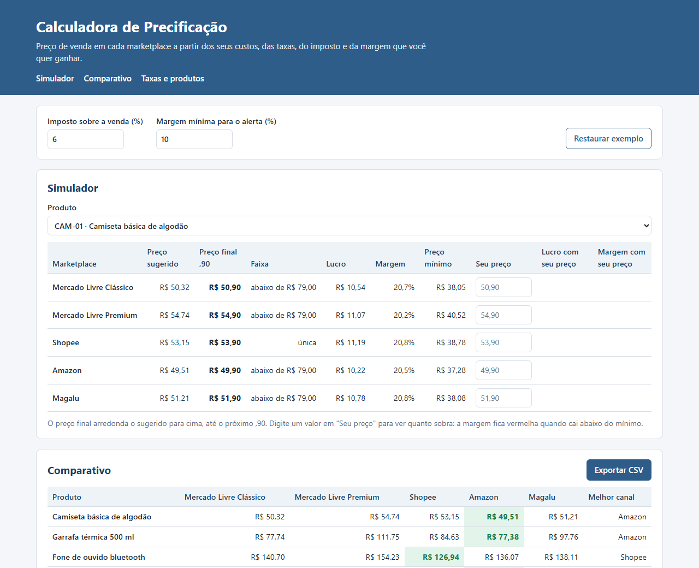

# Calculadora de Precificação para Marketplaces

Calcula o preço de venda de um produto em cada marketplace (Mercado Livre, Shopee, Amazon, Magalu...) a partir dos custos, das taxas, do imposto e da margem que o vendedor quer ganhar.

**Usar online:** https://hectorkaul.github.io/calculadora-precificacao/



## Por que eu fiz

Quem vende em marketplace costuma colocar o preço "no olho" e só descobre no fim do mês que algumas vendas deram prejuízo. Cada canal cobra de um jeito: comissão diferente, taxa fixa por venda e, em alguns, uma regra que muda a partir de um preço (por exemplo, o frete passa a ser do vendedor acima de R$ 79).

Eu já tinha feito essa conta numa planilha. Esta versão roda no navegador, inclusive no celular, sem instalar nada.

## O que ela faz

- **Simulador:** escolhe um produto e mostra, para cada marketplace:
  - o preço sugerido e o preço final com ",90";
  - o lucro, a margem real e o preço mínimo para não ter prejuízo.
- **"Seu preço":** digita um valor e vê na hora quanto sobra. A margem fica vermelha quando cai abaixo do mínimo que você definiu.
- **Comparativo:** todos os produtos em todos os marketplaces, marcando o canal onde dá para cobrar menos. Exporta para CSV, que abre direto no Excel.
- **Cadastro de taxas e produtos:** tudo editável. Os dados ficam salvos só no navegador de quem usa (`localStorage`).

> As taxas que vêm preenchidas são **exemplos** para a calculadora funcionar de primeira. Não são as taxas oficiais de cada marketplace.

## Como a conta funciona

```
preço = (custos do produto + taxas fixas) / (1 - comissão - antecipação - imposto - margem)
```

O ponto chato é quando o marketplace muda a regra a partir de um preço: a taxa depende do preço, e o preço depende da taxa. A solução foi calcular o preço nas duas faixas e ficar com o que fecha a conta. Se o preço da primeira faixa fica abaixo do limite, é ele. Se não, vale o da segunda.

Exemplo com os dados de exemplo: uma garrafa térmica sai por R$ 77,74 no Mercado Livre Clássico. No Premium, a comissão maior empurra o preço para cima de R$ 79, o frete entra na conta e o preço sugerido vai para R$ 111,75.

## Estrutura

| Arquivo | O que tem |
|---|---|
| `precificacao.js` | As regras de cálculo, sem nada de tela (dá para testar sozinho) |
| `comparativo.js` | Monta o comparativo e o CSV |
| `simulador.js` / `cadastro.js` | Desenham as tabelas na tela |
| `dados.js` | Dados de exemplo e o salvamento no navegador |
| `app.js` | Liga tudo |
| `*.test.js` | Testes com o `node:test`, que já vem no Node |

É HTML, CSS e JavaScript puro, sem framework e sem dependências.

## Rodando localmente

Os módulos JavaScript não funcionam abrindo o arquivo direto (`file://`). É preciso um servidor simples:

```bash
python -m http.server 8000
# abra http://localhost:8000
```

## Testes

```bash
node --test
```

Os testes rodam no GitHub Actions a cada push.

---

Feito por [Héctor Kaul dos Santos](https://github.com/hectorkaul).
